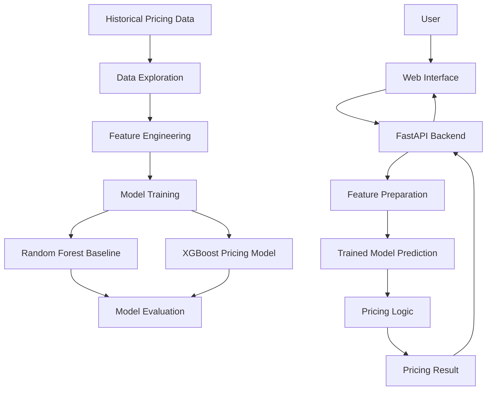

# Dynamic Pricing Engine

An end-to-end machine learning project that predicts product prices using pricing-related features and applies pricing logic to support data-driven pricing decisions.

The project combines machine learning, feature engineering, a FastAPI backend, and a web-based interface to demonstrate how predictive models can be integrated into a dynamic pricing application.

## Table of Contents

- [Overview](#-overview)
- [Problem Statement](#-problem-statement)
- [Key Features](#-key-features)
- [Technology Stack](#-technology-stack)
- [System Architecture](#-system-architecture)
- [Project Structure](#-project-structure)
- [Getting Started](#-getting-started)
- [Machine Learning Workflow](#-machine-learning-workflow)
- [Model Evaluation](#-model-evaluation)
- [Demo](#-demo)
- [Challenges and Learnings](#-challenges-and-learnings)
- [Future Improvements](#-future-improvements)

## Overview

The Dynamic Pricing Engine explores how machine learning can support pricing decisions by learning patterns from historical pricing data.

The application includes a dataset, data exploration scripts, feature engineering utilities, trained machine learning models, pricing logic, a FastAPI application, and a browser-based frontend.

The repository contains both a Random Forest baseline model and an XGBoost pricing model, allowing the project to support model comparison and experimentation.

## Problem Statement

Setting appropriate product prices can be challenging because pricing decisions may depend on several factors, including current prices, competitor prices, demand, inventory, product categories, and seasonal patterns.

A data-driven pricing system can learn relationships from historical data and provide predictions that help inform pricing decisions.

This project demonstrates a machine learning workflow for predicting prices and applying additional pricing logic through an application interface.

## Key Features

- **Machine Learning-Based Price Prediction:** Includes trained Random Forest and XGBoost models.
- **Feature Engineering:** Uses reusable utilities to prepare input features for prediction.
- **Pricing Logic:** Separates prediction functionality from additional pricing calculations.
- **REST API:** Uses FastAPI to expose backend functionality.
- **Web Interface:** Provides an HTML, CSS, and JavaScript frontend.
- **Exploratory Data Analysis:** Includes scripts and plots for examining pricing-related patterns.
- **Model Evaluation:** Stores model evaluation information in `models/metrics.json`.
- **Saved Model Artifacts:** Includes trained models and feature-column metadata.

The exact input fields and pricing adjustments should be documented according to the implementation in `src/features.py`, `src/pricing_logic.py`, and `app/main.py`.

## Technology Stack

| Component | Technologies |
|---|---|
| Programming Language | Python, JavaScript |
| Data Processing | NumPy, Pandas |
| Machine Learning | Scikit-learn, XGBoost |
| Hyperparameter Optimization | Optuna |
| Model Persistence | Joblib |
| Backend API | FastAPI, Uvicorn, Pydantic |
| Frontend | HTML5, CSS3, JavaScript |
| Data Visualization | Matplotlib |
| Development Tools | VS Code, Git, GitHub |

## System Architecture

The project separates data processing, model training, prediction logic, the API, and the user interface.



*This diagram illustrates the intended high-level workflow. Confirm the precise request and response flow against the current backend implementation.*

## API Endpoints

The FastAPI backend exposes the following endpoints.

| Method | Endpoint | Description |
|---|---|---|
| GET | `/health` | Returns API health and model-loading status. |
| POST | `/predict-price` | Generates a recommended price from the supplied product and market inputs. |

### Prediction Inputs

The `/predict-price` endpoint accepts a JSON request containing:

- `product_category`
- `base_price`
- `competitor_price`
- `inventory_level`
- `demand_signal`
- `day_of_week`
- `is_holiday`
- `customer_segment`

The API validates category, weekday, and customer-segment values, along with numeric constraints on price, inventory, and demand.

### Example Request

```json
{
  "product_category": "Electronics",
  "base_price": 249.99,
  "competitor_price": 239.50,
  "inventory_level": 340,
  "demand_signal": 145,
  "day_of_week": "Friday",
  "is_holiday": false,
  "customer_segment": "Regular"
}
```

### Prediction Response

The API returns a recommended price, the raw model prediction, and an adjustment breakdown containing the competitor-blended price, inventory adjustment percentage, and demand adjustment percentage.

Use the interactive API documentation at `/docs` to test requests against the running application.

## Project Structure

```text
Project2_Dynamic_Pricing_Engine/
│
├── app/
│   ├── __init__.py
│   └── main.py
│
├── data/
│   └── pricing_data.csv
│
├── frontend/
│   ├── index.html
│   ├── script.js
│   └── style.css
│
├── models/
│   ├── feature_columns.json
│   ├── metrics.json
│   ├── rf_baseline_model.joblib
│   └── xgb_pricing_model.joblib
│
├── outputs/
│   ├── demand_vs_price.png
│   ├── price_distribution.png
│   └── seasonality_competitor.png
│
├── scripts/
│   ├── eda.py
│   └── train_model.py
│
├── src/
│   ├── data_generation.py
│   ├── features.py
│   ├── predict.py
│   └── pricing_logic.py
│
├── requirements.txt
├── README.md
└── Dynamic_Pricing_Web.mp4
```

### Important Files

- `app/main.py` — Main FastAPI application.
- `data/pricing_data.csv` — Pricing dataset.
- `scripts/eda.py` — Exploratory data analysis.
- `scripts/train_model.py` — Model training workflow.
- `src/data_generation.py` — Data generation utilities.
- `src/features.py` — Feature preparation and engineering.
- `src/predict.py` — Prediction-related functionality.
- `src/pricing_logic.py` — Pricing calculation logic.
- `models/rf_baseline_model.joblib` — Saved Random Forest baseline model.
- `models/xgb_pricing_model.joblib` — Saved XGBoost model.
- `models/feature_columns.json` — Feature-column metadata.
- `models/metrics.json` — Stored evaluation information.
- `frontend/` — Web application interface.
- `outputs/` — Generated analysis visualizations.

## Getting Started

### Prerequisites

- Python installed on your system.
- Git installed on your system.
- Visual Studio Code or another code editor.
- A terminal for running Python commands.

### 1. Clone the Repository

```bash
git clone https://github.com/Priyadharshini-sk06/Dynamic_Pricing_Engine_Project-IV.git
cd Dynamic_Pricing_Engine_Project-IV
```

### 2. Create a Virtual Environment

**Windows PowerShell:**

```powershell
python -m venv .venv
.\.venv\Scripts\Activate.ps1
```

If the virtual environment already exists, activate it instead of creating it again.

### 3. Install Dependencies

```bash
python -m pip install -r requirements.txt
```

### 4. Start the Backend

From the project root, run:

```bash
python -m uvicorn app.main:app --reload
```

This assumes `app/main.py` exposes a FastAPI instance named `app`. If the instance has a different name or the application uses a different startup configuration, update this command accordingly.

### 5. Open the Application

With the standard Uvicorn configuration, the API runs at:

`http://127.0.0.1:8000`

FastAPI's interactive documentation is generally available at:

`http://127.0.0.1:8000/docs`

The frontend may be served separately or mounted by the backend. Follow the route and static-file configuration in `app/main.py` to open the correct dashboard URL.

## Machine Learning Workflow

The project contains several components supporting the machine learning pipeline.

### 1. Data Exploration

The dataset can be examined to understand pricing distributions and relationships among pricing-related variables.

The `scripts/eda.py` script and the generated visualizations support exploratory analysis.

### 2. Feature Engineering

The `src/features.py` module contains feature preparation utilities. Consistent feature preparation is important because prediction inputs must match the features expected by the trained model.

### 3. Model Training

The repository contains a Random Forest baseline and an XGBoost model.

The training script is located at `scripts/train_model.py`. Its implementation determines the training configuration, data split, tuning strategy, and model-saving procedure.

### 4. Price Prediction

The `src/predict.py` module supports prediction functionality using the project's saved model artifacts.

### 5. Pricing Logic

The `src/pricing_logic.py` module separates pricing calculations from the underlying machine learning prediction.

This separation makes it easier to maintain and test model inference and business rules independently.

## Model Evaluation

The project compares two regression models for product price prediction: a Random Forest baseline and a tuned XGBoost model.

### Model Performance

| Metric | Random Forest Baseline | Tuned XGBoost |
|---|---:|---:|
| MAE | 37.792 | 37.750 |
| RMSE | 86.165 | 85.097 |
| R² Score | 0.8514 | 0.8551 |
| MAPE | 28.65% | 29.64% |

*Source: `models/metrics.json`. MAE and RMSE are expressed in the dataset's raw currency units.*

### Results and Interpretation

- **MAE:** XGBoost achieves a slightly lower mean absolute error of 37.750 compared with 37.792 for Random Forest.
- **RMSE:** XGBoost achieves a lower RMSE of 85.097 compared with 86.165, indicating a modest improvement under this metric.
- **R² Score:** XGBoost achieves an R² of 0.8551, compared with 0.8514 for Random Forest.
- **MAPE:** Random Forest performs better on percentage error, with 28.65% compared with 29.64% for XGBoost.

Overall, tuned XGBoost performs slightly better on MAE, RMSE, and R², while Random Forest achieves the lower MAPE. The best model therefore depends on the evaluation metric and the business objective.

### XGBoost Hyperparameter Tuning

The project stores the selected XGBoost configuration in `models/metrics.json`. The recorded parameters include:

- `n_estimators`: 273
- `max_depth`: 7
- `learning_rate`: approximately 0.02654
- `subsample`: approximately 0.92487
- `colsample_bytree`: approximately 0.68227
- `min_child_weight`: 10
- `reg_alpha`: approximately 2.43822
- `reg_lambda`: approximately 0.12476

The project includes Optuna as a dependency for hyperparameter optimization.

**Note:** These metrics describe the project's recorded evaluation results. They should not be interpreted as a guarantee of performance on unseen production data.

## Exploratory Data Analysis

The `outputs/` directory contains visualizations related to pricing data:

- `demand_vs_price.png` — Demand and price relationships.
- `price_distribution.png` — Price distribution.
- `seasonality_competitor.png` — Seasonal and competitor-related patterns.

These plots can help communicate the patterns explored during development.

## Demo

Watch the application demonstration:

[▶️ Dynamic Pricing Engine Demo](./Dynamic_Pricing_Web.mp4)

The demonstration video is included in the repository.

## Challenges and Learnings

This project provides practical experience with:

- Preparing data for machine learning.
- Engineering features for price prediction.
- Training and saving regression models.
- Comparing a baseline model with an XGBoost model.
- Integrating prediction logic with a FastAPI backend.
- Separating model inference from pricing calculations.
- Building a frontend for interacting with a machine learning application.
- Evaluating model performance and interpreting exploratory visualizations.
- Organizing a machine learning project into reusable modules.

### Design Decisions

- **Random Forest baseline:** Provides a reference model for experimentation.
- **XGBoost:** Provides an additional gradient-boosting model for pricing prediction.
- **Separate feature and prediction modules:** Improve code organization and maintainability.
- **FastAPI:** Provides a structured way to expose backend functionality.
- **Independent frontend:** Separates user interaction from the backend implementation.
- **Stored model artifacts:** Allow the application to load trained models without requiring retraining for every prediction.

## Future Improvements

Potential improvements include:

- Comparing models using consistent evaluation datasets.
- Adding automated tests for feature engineering and pricing logic.
- Improving input validation and error handling.
- Supporting additional pricing signals where suitable data is available.
- Adding prediction history and downloadable reports.
- Deploying the application to a cloud platform.
- Monitoring prediction performance as new data becomes available.

These are proposed improvements, not claims about features already implemented.

## Author

**Priyadharshini S K**

B.Tech — Information Technology

[GitHub Profile](https://github.com/Priyadharshini-sk06)

## License

No license has been specified in this repository yet. Add an appropriate license file if you intend to distribute the project for reuse.

